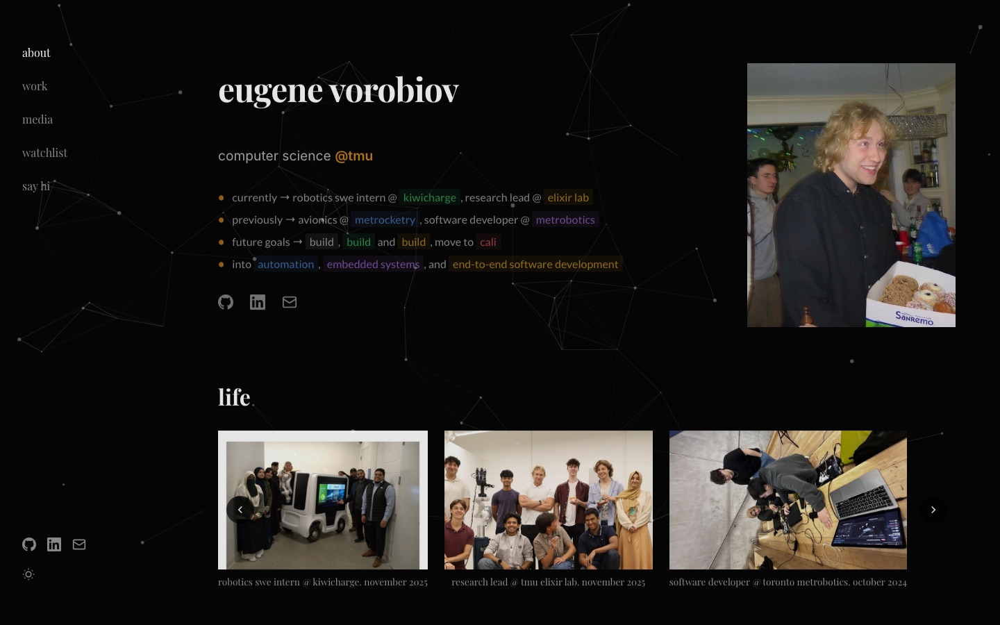
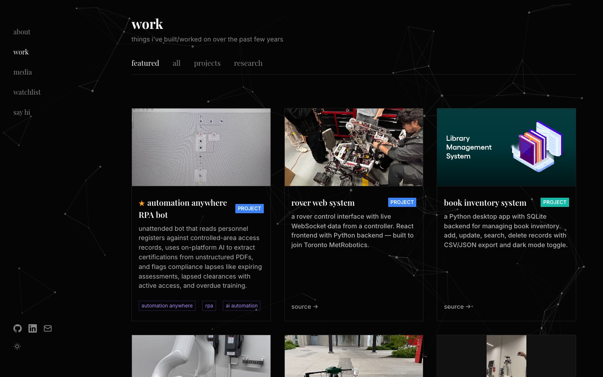
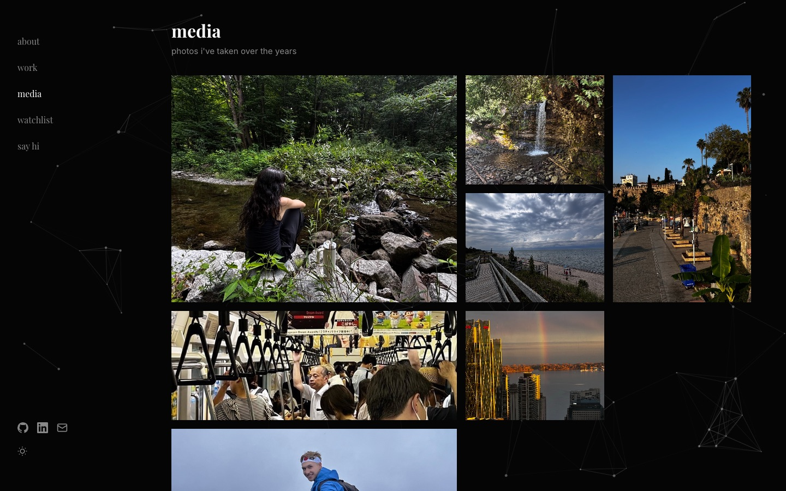
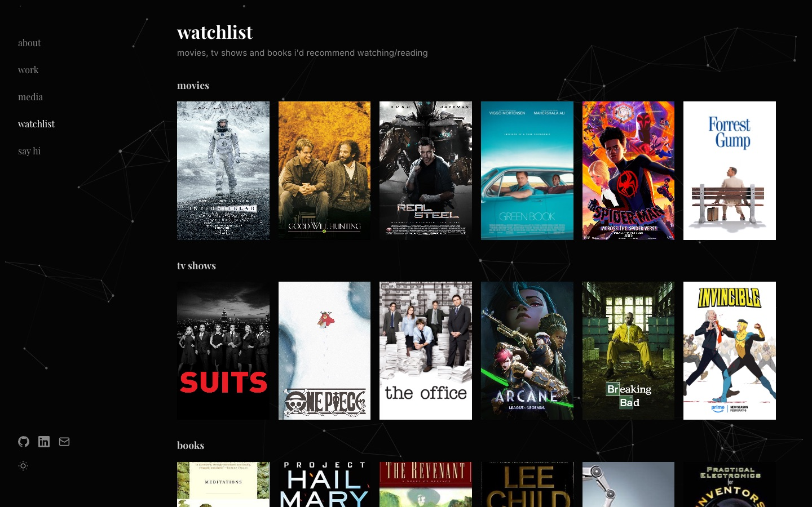

# portfolio

My personal site, a small corner of the internet where I keep what I've built, the photos I've taken, and the things I'd recommend to a friend.



I'm a computer science student at TMU, mostly into robotics, embedded systems, and building things end to end. A resume says what I did. I wanted a place that also shows who I am, so the site has some of my photos, a watchlist, and a way to just say hi.

## what's inside

- **about**: who I am right now, plus a few photos from the teams I've been part of
- **work**: projects and research, from robot arm autonomy to a 50V oscilloscope
- **media**: photos I've taken over the years
- **watchlist**: movies, shows, and books I keep coming back to
- **say hi**: a contact form, my local time, and a map







## how it's built

Plain HTML, CSS, and JavaScript with no framework or build step. It uses particles.js for the background, has a light/dark toggle, and is deployed on Vercel with Vercel Analytics.

The design is inspired by [abdullahr.com](https://abdullahr.com). Credit to Abdullah for the idea.

## running it locally

```bash
python3 -m http.server
```

Then open `http://localhost:8000`.
